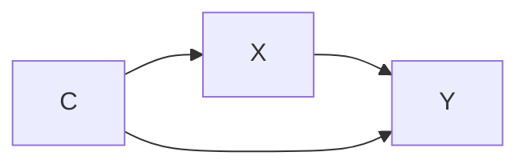

# Variable review, graph claims, and schema editing redesign

Updated: 2026-11-05

## Purpose and status

Combine the variable list and diagnostic-status controls into one review experience. Give schema editing a dedicated workspace, and make the consequences of each review decision visible on the graph.

This document records the agreed interface, dispositions, and graph-claim behavior. Via-X claims may establish a direct arrow into X. Suggest edge removals when the required changes are unambiguous; otherwise let the user select the affected edges. The graph can contain cycles. Distinguish decisions about evidence from claims about whether a causal effect exists. Remaining interface details are listed separately.

The broader redesign is a plan, not a description of functionality already implemented. Some supporting improvements already exist on the follow-up branch: clearer selection feedback, saved-split replacement previews, smaller subsection headings, synchronization with the top diagnostic selector, and lighter fills for controlled/design-addressed confounders. The lighter-fill legend entry has also been added locally.

## 1. Main interface

### One variable-review list

- Combine **Variables on map** and the separate **Confounder status** controls into one list.
- Remove the inclusion tickboxes, including the section-level bulk tickboxes.
- In the confounder view, give each variable a disposition dropdown.
- Keep the sidebar synchronized with the diagnostic selected in the top toolbar. Do not reintroduce a separate All/Confounders/Colliders selector.
- Keep **Variables on map** visually above its subsection headings. Custom and built-in variables may remain subsections for the initial redesign; whether to replace that grouping has not been decided.
- Clicking a variable should still allow inspection of its definition, concepts, and evidence.

### Controls below the title

Immediately below **Variables on map**, provide:

- **Edit variable schema**
- **Filter**

Replace the existing Create control with **Edit variable schema**. Create, edit, delete, and saved-split operations belong in that workspace rather than beside diagnostic dispositions.

The filter retains the relevant existing filtering capabilities. Any changes to its contents or scope should be specified separately.

### Visible bottom section

- Provide a visibly labeled **Rejected candidates (N)** section at the bottom of the list.
- Keep the variable name and its recorded disposition accessible there.
- Let the user change the disposition to restore the variable where applicable.
- Preserve keyboard focus when a disposition moves a row.
- Keep lighter-shaded variables in the main list, with fully readable labels and controls.

Use **Rejected candidates** for variables rejected by a disposition or whose recorded graph claim means they no longer qualify. A rejected candidate can remain in the schema and may still appear as an intermediate variable on the effective graph. Whole-variable removal is reserved for **Removed for other reason**. Retain each reviewed variable’s disposition and any supporting note in this section.

## 2. Confounder dispositions

Use these user-facing labels:

| Disposition | Agreed visual treatment | Effect on diagnostic calculations |
| --- | --- | --- |
| Unaddressed | Normal fill; main list | No removal or rewiring from this disposition |
| Explicitly controlled | Lighter fill; main list | No automatic graph change |
| Accounted for by design | Lighter fill; main list | No automatic graph change |
| Affects outcome only via cause | Preview the claim; move the review row to Rejected candidates after confirmation | Establish a direct arrow into X, apply confirmed edge removals, then recalculate |
| Not in minimal adjustment set | Lighter fill; main list | No automatic graph change |
| Removed for other reason | Remove the whole variable from the effective graph; move its row to Rejected candidates | Recalculate without the variable and its incident edges; require a note |

Here X is the selected cause and Y is the selected outcome. The interface must make that relationship understandable; whether labels should substitute the selected variable names is not yet decided.

Selecting **Unaddressed**, **Explicitly controlled**, **Accounted for by design**, or **Not in minimal adjustment set** restores a variable previously removed by its disposition, subject to the graph-claim restoration rules below.

**Not in minimal adjustment set** is a user-recorded judgment in the proposed first version. The interface should not imply that the application has computed or validated a particular adjustment set unless that capability is explicitly implemented.

## 3. Collider view

- Show the collider variables as a plain list for now.
- Do not add the proposed confounder disposition dropdowns to colliders.
- Remove inclusion tickboxes as part of the unified-list redesign.
- Preserve variable inspection and the top-toolbar selection behavior.

Existing recorded collider statuses should not be deleted merely because their editing controls are absent from this design.

## 4. Exclusion restriction violations

Use these user-facing labels:

| Disposition | Visual treatment | Calculation behavior |
| --- | --- | --- |
| Unaddressed | Normal fill; main list | Retain the baseline relationships |
| Explicitly controlled for | Lighter fill, with a warning symbol | No automatic rewiring |
| Instrument affects variable only via cause | Preview the claim; move the review row to Rejected candidates after confirmation | Establish the instrument’s direct arrow into X where needed; apply confirmed edge removals and recalculate |
| Affects outcome only via cause | Preview the claim; move the review row to Rejected candidates after confirmation | Establish the variable’s direct arrow into X; apply confirmed edge removals and recalculate |
| Removed for other reason | Remove the whole variable; move its row to Rejected candidates; require a note | Recalculate without the variable and its incident edges |

Use **Removed for other reason**, not **Other**, consistently in both diagnostics. Whole-variable removal is distinct from separately pruning particular edges.

The warning tooltip for **Explicitly controlled for** must say:

> Controlling for exclusion restriction violations can induce post treatment bias.

Make the warning available on keyboard focus as well as pointer hover. Its exact placement is an implementation detail; the disposition and warning should be visibly associated.

Exogeneity/common-cause-of-instrument decisions have not been redesigned in this discussion. Do not automatically apply these exclusion-restriction reasons to that diagnostic.

## 5. Graph appearance and key

### Lighter shade

- Use a lighter background fill for explicitly controlled and design-addressed confounders.
- Also use the lighter shade for **Not in minimal adjustment set** in the redesign.
- Preserve readable node text and the lighter background during hover and selection.
- Refresh the graph immediately when the disposition changes.
- The exclusion-restriction **Explicitly controlled for** treatment includes its warning; lighter fill must not be presented as validation that the decision is appropriate.

### Key

- Include the lighter shade in the graph key.
- The local entry currently reads **Explicitly controlled / accounted for by design**.
- When **Not in minimal adjustment set** is implemented, expand the key to include that meaning as well. The exact concise wording remains an interface-copy decision.
- Add a separate key entry for dotted user-claimed direct effects, including direct arrows into X established by a via-X disposition. Do not use the same visual convention for an indirect path summary without clearly distinguishing it.

## 6. Diagnostic calculations and graph claims

### Calculation rules

Distinguish visual treatment from changes to the graph used to calculate diagnostics:

- Controlled, design-addressed, and minimal-adjustment-set dispositions do not automatically change that graph.
- **Removed for other reason** does change it.
- Separately pruned edges also change it.
- Merely recording a display disposition should not silently make other candidates disappear.

The **via X** reasons express graph claims. Represent them by confirmed graph changes rather than simple node hiding.

### Baseline and study graphs

Maintain a distinction between:

1. The baseline schema and evidence relationships.
2. The effective graph for the current study, incorporating confirmed substantive removals, separately pruned edges, and graph claims.
3. Visual styling applied to that study graph.

Run confounder, collider, and exclusion-restriction calculations on the effective study graph. Preserve the baseline evidence so changes can be inspected and undone. Applying a study-specific claim should not silently overwrite a shared variable definition or the original evidence records.

### Meaning of the via-X claims

| Reason | Path claim |
| --- | --- |
| Affects outcome only via cause | No directed path from this variable to Y bypasses X |
| Instrument affects variable only via cause | No directed path from the instrument to this variable bypasses X |
| Affects outcome only via cause | No directed path from this variable to Y bypasses X |

In addition to rejecting bypassing paths, these dispositions authorize a direct arrow into X as a user claim: C → X for Affects outcome only via cause, instrument → X for Instrument affects variable only via cause, and variable → X for Affects outcome only via cause. Show a newly established effect as a dotted arrow, identified as a study-specific claim rather than new evidence. Reuse an existing direct effect rather than drawing a duplicate. This decision does not independently authorize inventing other direct effects, such as X → variable when only an indirect downstream path is known.

### Concrete example

Suppose the baseline graph is:

Choosing **C causes Y only via X** rejects the direct C → Y edge. Removing that edge leaves C → X → Y.

If the graph also contains C → M → Y, the same claim rejects that bypassing path, but does not determine whether C → M or M → Y is wrong. The application must not silently choose which relationship to reject.

If C previously reaches X only through an intermediate variable, this disposition can establish a dotted C → X arrow in the effective study graph. The preview must make that asserted direct effect explicit. Do not remove the existing intermediate path solely because the direct arrow has been added.

### Preview and confirmation

- Selecting a via-X reason opens a preview of the proposed study-graph changes.
- List the exact relationships to be removed and any direct effects the user is asserting.
- Show the direct arrow into X established by the disposition, and draw newly asserted direct effects with dotted lines.
- Remove rejected direct effects from the effective study graph after confirmation.
- Suggest the rejected edges when the change is unambiguous. When more than one edge change could satisfy the claim, require the user to select the affected edges rather than choosing arbitrarily.
- Explain when the proposed changes do not satisfy the selected claim. Allow directed cycles; the graph is not required to be a DAG, and a cycle is not itself a conflict.
- Flag only direct contradictions with earlier decisions about the same causal proposition in the same study scope. Do not impose a general confirmation block based on cycles or differing evidence assessments.
- Cancel leaves the graph and recorded disposition unchanged.
- Confirm records the decision and graph changes together as an undoable action, then recalculates diagnostics.
- Preserve a visible review record when the decision means the variable no longer qualifies as a candidate.

The preview/confirmation behavior and handling of ambiguous edge removals are agreed. Exact preview layout and interaction details can be designed during implementation.

### Restoration and independent decisions

Returning a substantively removed variable to another disposition should restore it to the effective graph and recalculate diagnostics. It should not restore edges the user pruned independently.

Track the origin and meaning of graph changes so undoing one disposition does not erase an independent decision.

### Evidence judgments, causal claims, and conflicts

- Rejecting a finding or its supporting evidence is not equivalent to asserting that the causal effect does not exist.
- A user can reject the available evidence for an edge and still assert that the edge exists. Preserve both decisions, and represent the asserted effect with the dotted-line convention where appropriate.
- Record whether an operation rejects evidence, hides an effect from the current analysis, or explicitly claims that a direct effect does not exist. Do not infer the strongest claim from a generic exclusion action.
- Use a high bar for a conflict: for example, an explicit claim that A directly causes B and an explicit claim that this same direct effect does not exist, in the same study scope.
- Opposing directed effects, feedback, and cycles are permitted; they are not contradictions merely because they form a cycle.
- Flag a direct contradiction for review without silently deleting or overwriting an earlier decision. A flag is not automatically a prohibition on confirmation.
- Preserve provenance for both decisions so the user can inspect and revise them.
- Diagnostic traversal and path enumeration must terminate on cyclic graphs. Do not implement this redesign using algorithms that assume a DAG.

## 7. Notes, scope, persistence, and counts

### Supporting notes

- Show a supporting-notes field only for **Removed for other reason** in the first version, and require its completion.
- Other dispositions do not have optional notes fields in the first version.
- Keep supporting notes private when publishing. Preserve existing stored notes even where the new interface does not expose an editing field.

### Decision scope

- Confounder decisions remain scoped to the selected cause–outcome pair.
- Reopening a pair restores its saved decisions.
- Scope exclusion-restriction decisions to the instrument–cause–outcome combination.
- Scope disposition-generated graph changes to the same cause–outcome pair or instrument–cause–outcome combination as the disposition. Restoring a disposition preserves independently rejected edges and decisions; study-specific claims do not change the global schema.

### Top-toolbar counts

- Count all detected candidates, including those moved out of the main list solely for display.
- Lighter fills and display-only removals do not reduce the count.
- Confirmed changes to the effective graph can legitimately change diagnostic counts.
- The bottom section has its own count.
- Keep reviewed variables that no longer qualify in Rejected candidates; do not count them as currently detected candidates. The section count reports its retained review rows.

### Save and publish

- Save each completed schema create/edit operation, with undo.
- **Back to analysis** is navigation, not an Apply-all action.
- Saving edits is separate from the existing publication workflow.
- Do not publish automatically when saving a disposition, confirming a graph claim, or completing a schema edit.
- When the user explicitly publishes, include the dispositions and scoped graph changes needed to reproduce the study. Exclude private supporting notes from public artifacts.

## 8. Edit variable schema workspace

Open **Edit variable schema** in the main panel and preserve the user's current study context.

Provide:

### In this schema

- Inspect existing variables and their source groups.
- Edit variables through supported editing flows.
- Create a variable from existing source groups.
- Remove a custom variable through the supported operation that returns its concepts to its sources.
- Make consequences for currently selected study variables explicit.

### Saved splits

- Review saved splits and add compatible ones to the current schema.
- Combine local and published saved copies.
- Show source-group names; omit Local/Published tags and save dates from the listings, following the later interface feedback.
- Show the most recent eligible saved copy for each name, ignoring capitalization and surrounding spaces.
- Filter for compatibility before selecting the newest copy.
- Hide records whose compatibility or source information cannot be verified.
- Adding from this workspace does not assign cause, outcome, instrument, or focus.
- Add a saved split as-is; editing happens afterward through the ordinary variable-editing flow.
- Keep the current source-group names.
- Preserve the saved split's originating identity so subsequent reuse checks recognize it.

Return to the workspace list with a newly added variable highlighted. **Back to analysis** restores the prior analysis view.

Initially expose the existing supported create, split, edit, delete, and saved-split operations. Do not introduce arbitrary new built-in membership or definition editing in this redesign.

## 9. Saved-split selection and replacement

Retain the recently specified picker behavior:

- Accepted variable selections have a distinct appearance and a visible selected indicator.
- Saved-variable rows have enough room for their action labels.
- Selecting a saved variable opens a dedicated loading state followed directly by review, without flashing creation or AI screens.
- When replacing a selected custom split, offer alternatives that would be viable if that box's current split were undone.
- Build that restored schema only as a preview; do not modify the live schema before confirmation.
- Explain which split the alternative replaces.
- Confirm applies the replacement as one undoable operation; cancel preserves the existing split.
- Do not remove a variable still needed by a different study role merely to make an alternative appear compatible.

These operations edit the schema. They remain distinct from assigning a diagnostic disposition to an existing variable.

## 10. Remaining open details

1. Design the presentation of a direct-contradiction flag and the interaction for inspecting or revising the conflicting decisions. Do not turn the flag into a blanket prohibition or treat cycles or evidence rejection as contradictions.
2. Finalize concise key wording, selected-variable-name substitution in the via-X labels, and the graph-change preview layout.

The direct arrow into X, Rejected candidates section, whole-variable removal for Removed for other reason, decision scoping, initial schema-editing scope, cycle support, publication of reproducible study decisions, private notes, and notes-field availability are settled.

## 11. Suggested implementation sequence

1. Finalize graph-claim semantics and the open decisions above.
2. Introduce scoped disposition records and migrations for existing confounder statuses, preserving recorded decisions and notes.
3. Separate the baseline graph, effective study graph, and visual styling; implement provenance for reversible graph changes.
4. Build the combined confounder list, notes, bottom section, restoration behavior, and lighter-fill key.
5. Keep colliders as a plain list; build exclusion-restriction review using the finalized options and warning.
6. Add graph-change previews, confirmation, cancellation, and undo.
7. Build the main-panel **Edit variable schema** workspace using the existing schema and saved-split operations.
8. Verify persistence, navigation, graph/table consistency, publication boundaries, and keyboard/mobile behavior.

## 12. Acceptance criteria

- One list replaces the variable tickboxes and separate confounder-status list.
- The top diagnostic selector drives the list and graph consistently.
- Every agreed disposition has the specified visual treatment and calculation behavior.
- Lighter-shaded nodes retain readable text, visible paths, and stable hover/selection styling; the key explains their meaning.
- Exclusion-restriction control warnings expose the exact agreed tooltip text.
- A required note cannot be omitted for **Removed for other reason**.
- No notes field is shown for other dispositions in the first version; private supporting notes are excluded from publication.
- Moving a row preserves focus and gives it a visible, understandable destination.
- Graph claims preview exact edge removals and any direct arrow into X established by the disposition. Newly asserted effects use dotted lines, do not overwrite evidence, and do not mutate the live graph before confirmation.
- Cyclic graphs and opposing directed effects remain supported; path calculations terminate without rejecting cycles.
- Rejecting evidence and asserting the corresponding causal effect can coexist. Only direct contradictions about the same proposition and scope receive conflict flags.
- Cancelling a claim or split replacement preserves the existing study and schema.
- Undo restores the relevant decision without undoing independently pruned relationships.
- Restoring a disposition updates the graph and diagnostics correctly.
- Candidate counts distinguish visual changes from substantive graph changes.
- Confounder decisions and their graph changes persist per cause–outcome pair; exclusion-restriction decisions and their graph changes persist per instrument–cause–outcome combination.
- Schema edits save independently of publishing and return the user to the prior analysis context.
- Explicit publication includes dispositions and scoped graph changes sufficient to reproduce the study while preserving notes privacy.
- Saved alternatives remain discoverable when viable after undoing the currently selected split.
- Existing review records survive migration, including collider statuses that are not editable in the initial redesigned collider list.
